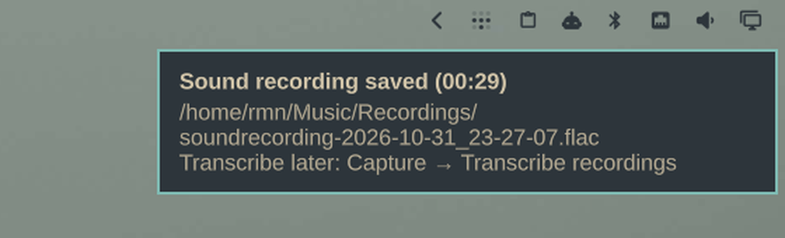

# Voice Memo — Omarchy shell plugin

Bar widget for a mic voice-memo pipeline: record toggle, live elapsed time,
and an un-transcribed recordings badge. The recorder toggle (pw-record →
FLAC, with a race-safe state file) is bundled; transcription
(`omarchy-voicenote`) is an optional companion script.

The widget watches the recorder's runtime state file and the recordings
folder, so it stays in sync with the keybind, the menu, and anything else
that drives the same state conventions.

## Screenshots

While recording — recorder glyph with live elapsed time in the alert color:


Idle with one un-transcribed recording in the backlog:


After clicking stop (or toggling the keybind) — the save notification:


## Install

```bash
omarchy plugin add https://github.com/RmnSoni/voicememo
```

Then place the widget in the bar:

```bash
omarchy bar put io.github.rmnsoni.voicememo --section center
```

(or add `{"id": "io.github.rmnsoni.voicememo"}` to `~/.config/omarchy/shell.json`).

The recorder toggle is bundled with the plugin (`soundrecord.sh` — a small
pw-record wrapper: SUPER-SHIFT-R-style toggle, FLAC into
`~/Music/Recordings`, flock-guarded so a double keypress can never spawn a
second recorder, and orphan cleanup if a state file is lost). Transcription
(`omarchy-voicenote`, a personal script) is not shipped; without it the
transcribe click does nothing and the widget still works fully as an
indicator: recording state, live elapsed time, and un-transcribed backlog.

**Dependencies:** bash, coreutils and `pw-record` from pipewire (all ship
with Omarchy). Notifications go through `omarchy-notification-send`;
transcribe click shells out to `omarchy-voicenote` when present; folder
clicks use `xdg-open`.

Recordings are created with owner-only permissions (`0600`), and newly
created recording directories are private (`0700`). Existing directories
and older recordings keep their current permissions. Each recording gets
a unique filename so an existing file is never reused.

### Remove

```bash
omarchy plugin remove io.github.rmnsoni.voicememo
```

Stops working immediately; recorded files stay in `~/Music/Recordings`.

## Widget behaviour

- **Recording** — polls `${XDG_RUNTIME_DIR}/omarchy-soundrecording` (the
  state file written by `omarchy-soundrecord`) once a second; while
  recording shows the recorder glyph with live elapsed time in the alert
  color. Click stops the recording.
- **Backlog badge** — counts `*.flac` in the recordings folder that have no
  sibling `.txt` (i.e. not yet transcribed by `omarchy-voicenote`); shows mic
  glyph + count when idle, hidden when everything is processed.
- **Hidden when idle with no backlog** (same behaviour as the built-in
  indicators).

### Clicks

| Button | Action |
|---|---|
| Left | Toggle recording (bundled pw-record wrapper) |
| Middle | `omarchy-voicenote --all` — transcribe every unprocessed recording |
| Right | Open the recordings folder |

## Settings

| Key | Default | Meaning |
|---|---|---|
| `recordDir` | *(empty)* | Override recordings folder; empty follows `OMARCHY_SOUNDRECORD_DIR` / `XDG_MUSIC_DIR` (default `~/Music/Recordings`) |
| `showPending` | `On` | Badge for un-transcribed recordings |

## How it works

One bash probe per second emits a single line:

```
recording|startedEpoch|pendingCount|recordDir
```

parsed in QML; the elapsed time is interpolated locally on a 500 ms timer so
no extra process spawns between probes. The widget uses the public
`WidgetButton` (same text path as the built-in clock, auto-width labels).

Fails soft: if a probe fails, the widget simply hides until the next tick.

## License

MIT — see [LICENSE](LICENSE).
